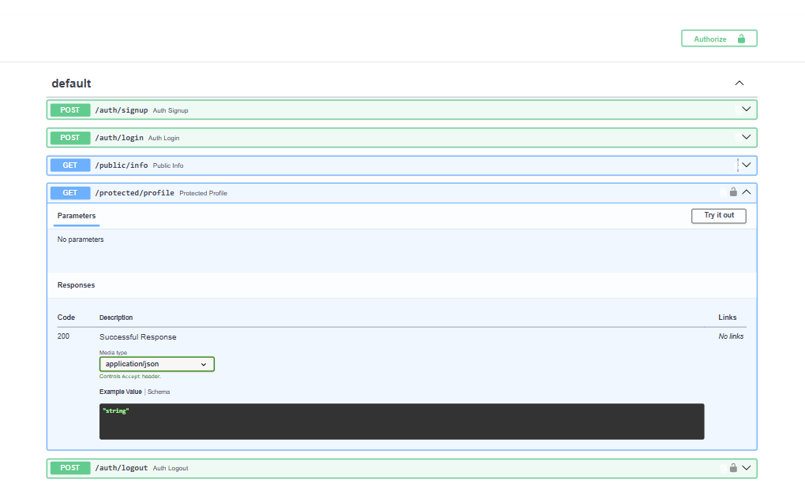

# FastAPI + Supabase Auth

A small FastAPI service that delegates **user accounts and token issuing to Supabase Auth** and protects its own routes by verifying the bearer token on each request. Built for the FlyRank Internship Backend Track (Week 2, Assignment A4: Login & Protect).

It is a learning project about the authentication flow and route protection, **not production-ready authentication** (see Limitations).

## What it does

- `POST /auth/signup` and `POST /auth/login` call Supabase Auth and return its response (login returns the access and refresh tokens).
- `GET /protected/profile` requires an `Authorization: Bearer <access_token>` header and returns the user's id, email and account creation time.
- `GET /public/info` needs no token.
- `POST /auth/logout` requires a valid token
- Interactive docs with an **Authorize** button at `/docs` (Swagger UI / OpenAPI).

## How authentication works

```text
Client ── email + password ──▶ FastAPI ──▶ Supabase Auth
                                              │ validates credentials, issues JWT
Client ◀──── access token ◀── FastAPI ◀───────┘

Client ── Authorization: Bearer <token> ──▶ FastAPI
                                              │ supabase.auth.get_user(token)  (network call)
                                              ▼
                              valid → route runs   |   invalid → 401
```

The app creates no JWTs and does not verify signatures itself. Each protected request calls Supabase's `get_user` to validate the token, which is simple and always current but adds a network round trip per request. Protection is a reusable FastAPI dependency (`get_current_user`) applied with `Depends(...)`.

**Stack:** Python 3.10+ · FastAPI · Supabase (supabase-py) · Pydantic · python-dotenv.

## Setup

```bash
git clone https://github.com/waniamaqsood/fastapi-supabase-auth.git
cd fastapi-supabase-auth
python -m venv venv
source venv/bin/activate          # Windows: venv\Scripts\activate
pip install -r requirements.txt
cp .env.example .env              # then fill in your Supabase project values
```

`.env`:

```env
SUPABASE_URL=https://<your-project>.supabase.co
SUPABASE_KEY=<your anon (publishable) key>
```

Use the **anon** key. The `service_role` key must never be used here or committed. The app refuses to start if either variable is missing.

```bash
uvicorn main:app --reload
```

Open <http://127.0.0.1:8000/docs>.

## API

| Method | Path | Auth | Purpose |
|---|---|---|---|
| `POST` | `/auth/signup` | none | Create an account (201) |
| `POST` | `/auth/login` | none | Get tokens (200; 401 on bad credentials) |
| `GET` | `/public/info` | none | Public message (200) |
| `GET` | `/protected/profile` | Bearer | User id, email, created time (200; 401) |
| `POST` | `/auth/logout` | Bearer | See Limitations (204; 401) |

```bash
curl -i http://127.0.0.1:8000/public/info                      # 200
curl -i http://127.0.0.1:8000/protected/profile                # 401 {"detail":"Not authenticated"}
curl -i http://127.0.0.1:8000/protected/profile \
  -H "Authorization: Bearer <access_token>"                    # 200 with a valid token
```

Invalid or expired tokens return `401` with `{"detail": {"error": "Invalid or expired token"}}`. Missing signup/login fields return `422` (FastAPI validation).



## Testing

There are no automated tests yet. Manual checks:

1. `GET /public/info` → 200.
2. `GET /protected/profile` with no header, a malformed scheme, or a made-up token → 401.
3. Sign up, log in, then call `/protected/profile` with the returned `access_token` → 200.

## Limitations

- /auth/logout validates the token and requests sign-out from Supabase. Session revocation was not confirmed in testing, so treat it as best-effort.
- Login stores its session on one shared client. That’s fine for a demo, but not for a multi-user service.
- Error handling is coarse. Signup has none (any Supabase error becomes a 500); login and token verification turn every exception, including a Supabase outage, into a 401.
- `email` is not validated as an email address; there is no password policy, rate limiting, refresh-token flow, or role/permission model.
- Dependencies are unpinned and there are no automated tests.
- Signup returns Supabase's raw response object.
